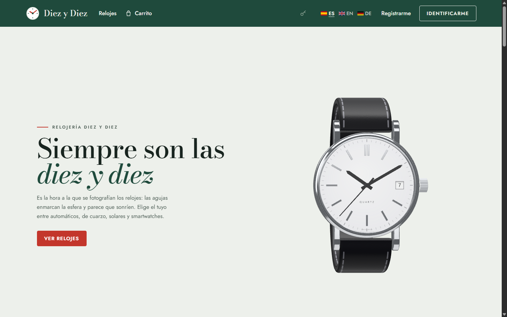
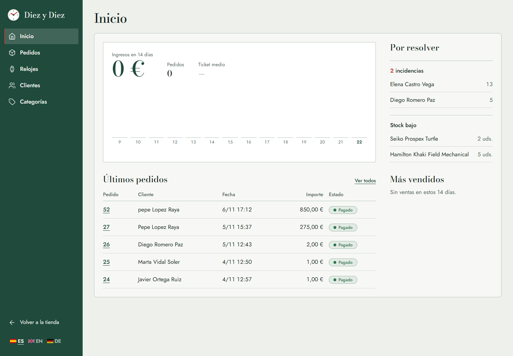
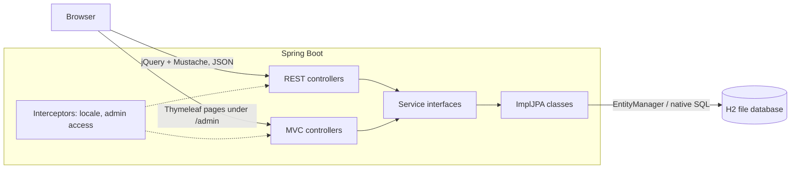

# Diez y Diez

Full-stack watch e-commerce application built with Spring Boot.

Diez y Diez is an academic project (2nd year, Client-Server module). It combines a single-page storefront backed by JSON endpoints, a server-rendered administration panel, and an interactive 3D hero built with Three.js. It runs locally against a file-based H2 database that is seeded on first start.


## Preview

| Storefront hero (Three.js, random watch on each visit) | Administration dashboard |
|---|---|
|  |  |

## Features

**Storefront**
- Catalog with search and server-side pagination (10 watches per page) and several photos per watch.
- Product detail view with an image carousel.
- Shopping cart for guests and for signed-in customers; signed-in carts are persisted in the database.
- Three-step checkout (shipping data, payment data, confirmation), with a stock check before the order is confirmed.

**Customer account**
- Registration, sign-in, profile editing and password change.
- Order history ("My orders") with the option to repeat a previous order.

**Administration** (`/admin/...`)
- Dashboard: revenue for the last 14 days, best sellers, latest orders, open incidents and low stock.
- CRUD for watches (with image upload), categories, orders (status changes) and customers.

**3D experience**
- The home page hero renders one of 10 procedurally built watch models with Three.js, chosen at random, and disassembles it as the user scrolls.
- The 3D hero is only started when WebGL 2 is available and `prefers-reduced-motion` is not set.

**Localization**
- Spanish, English and German. The language is switched with `?idioma=es|en|de` and kept in the session. UI strings live in `messages*.properties` and are served to the JavaScript storefront through a REST endpoint.

## Technology stack

| Area | Technology |
|---|---|
| Language / build | Java 17, Maven (Maven Wrapper included) |
| Backend | Spring Boot 4.1.1: Web MVC, Data JPA, Validation, Thymeleaf |
| Persistence | JPA / Hibernate through `EntityManager`; native SQL for listings and dashboard figures |
| Database | H2, file mode (`./data/bd_relojes`), `ddl-auto=update` |
| Storefront | jQuery 4 + Mustache.js 3 (HTML templates fetched and rendered client-side) |
| Admin UI | Thymeleaf templates |
| Styling | Tailwind CSS 4 (browser build, bundled in `static/librerias_js`) |
| 3D | Three.js 0.165, loaded from jsDelivr through an import map |
| Other | Gson, Commons IO |
| Tests | Spring Boot context-load test; Node's built-in test runner for the 3D choreography logic |

## Architecture



- **Public storefront**: `index.html` is the only page. `tienda.js` and the modules in `static/js/tienda/` call the `restRelojes`, `restCarrito`, `restPedidos`, `restUsuarios` and `restIdioma` endpoints and render the results with Mustache templates from `static/plantillas_html/`.
- **Administration**: Thymeleaf pages served by `ControladorRelojes`, `ControladorCategorias`, `ControladorPedidos` and `ControladorUsuarios` under `/admin/`. `InterceptorAdmin` redirects to the login page unless the session holds the `admin` attribute.
- **Services**: each service is an interface in `servicios/` with one `ImplJPA` implementation in `serviciosImpl/`. Controllers depend only on the interfaces.
- **Persistence**: implementations use `EntityManager`, with native SQL kept in `ConstantesSQL`. Several endpoints return `List<Map<String, Object>>` directly as JSON.
- **Images**: stored as bytes in the database and served by `ControladorImagen` (`mostrar_imagen`, `mostrar_miniatura`, `mostrar_imagen_extra`, `mostrar_avatar`).

### Example flow: placing an order

1. The browser calls `restPedidos/paso1` and `restPedidos/paso2` with the shipping and payment forms.
2. `PedidosREST` reads the signed-in user from the HTTP session (`usuario_identificado`) and rejects the call if there is none.
3. `ServicioPedidosImplJPA` (a `@Transactional` class) stores the data on the order.
4. `restPedidos/confirmar` checks the stock of every watch in the cart before changing anything, then moves the cart lines into the order and decrements the stock.
5. The storefront renders the summary from `restPedidos/resumen`.

## Getting started

**Requirements:** JDK 17 or later and, for the 3D hero, an internet connection (Three.js is loaded from a CDN). Maven is not required; the wrapper is included.

```bash
git clone https://github.com/josemdelcampolopez/diez-y-diez-relojes.git
cd diez-y-diez-relojes
./mvnw spring-boot:run
```

On Windows PowerShell use `.\mvnw.cmd spring-boot:run`.

Then open <http://localhost:8080>. On first start the database is created in `./data` and seeded with watches, categories, customers and sample orders (`ServicioSetUp`, triggered from `ControladorInicio`).

Optional tests (stop the app first: the Spring test uses the same H2 file):

```bash
./mvnw test
node --test src/test/js/
```

## Demo data

Local test data only, defined in the seed code and in `InterceptorAdmin`:

| Access | Where | Credentials |
|---|---|---|
| Customer | Home page, "Identificarme" | `pepe@ejemplo.com` / `123` |
| Administration | `/loginAdmin` | password `123` |
| H2 console | `/h2-console` | JDBC URL `jdbc:h2:file:./data/bd_relojes`, user `sa`, empty password |

## Project structure

```text
src/main/java/com/chema/tienda/relojes/
├── controladoresREST/       JSON endpoints used by the storefront
├── controllers/             Thymeleaf controllers for the admin panel
├── controladorImagen/       Image-serving endpoints
├── servicios/               Service interfaces
├── serviciosImpl/           JPA implementations (EntityManager)
├── model/                   JPA entities
├── constantesSQL/           Native SQL queries
├── responseData/            Response objects for the JSON API
└── interceptores/           Admin access control
src/main/resources/
├── templates/               index.html, admin views, Thymeleaf fragments
├── static/js/               Storefront scripts; relojes3d/ holds the Three.js models
├── static/plantillas_html/  Mustache templates
└── messages*.properties     Spanish (default), English, German
src/test/                    Context-load test (Java) and 3D logic tests (Node)
screenshots/                 Images used in this README
```

## Technical highlights

- **Layered backend without extra frameworks.** Interfaces plus `ImplJPA` classes keep controllers independent of persistence. Queries are written by hand against `EntityManager`, with native SQL isolated in one constants class.
- **JSON-driven storefront.** The public site is one HTML page; behaviour is split into small scripts and views are Mustache templates, so moving between catalog, cart, checkout and account does not reload the page.
- **Order workflow.** Checkout data is stored on the order step by step; confirmation validates stock for all lines first and then applies the changes in a transactional service.
- **Procedural 3D watches.** The ten models are built in code (`static/js/relojes3d/`), and the scroll-to-animation calculations live in a pure module (`coreografia.js`) covered by 12 Node tests.
- **Runtime localization.** `SessionLocaleResolver` and `LocaleChangeInterceptor` select the language; `IdiomaREST` exposes the current message bundle so client-side templates use the same files as the server.

## Scope and limitations

This is an educational project, not production software.

- Passwords are stored and compared in plain text, and the admin "login" is a single hard-coded password checked in an interceptor. There is no Spring Security, CSRF protection or role model.
- The payment step is a form only: there is no payment gateway, and the card data entered is saved in plain text on the order.
- The database is a local H2 file with its console enabled; there is no deployment configuration.
- Three.js is loaded from a CDN, so the 3D hero needs internet access.
- Test coverage is minimal: one Spring context-load test and the Node tests for the 3D logic.

## License

[MIT](LICENSE). Bundled third-party libraries (jQuery, Mustache.js, Tailwind CSS) are under their own MIT licenses.

## Author

[josemdelcampolopez](https://github.com/josemdelcampolopez)